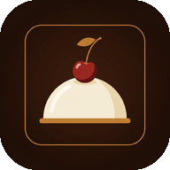

<div align="center">



# BestellBack

**Commandes, caisse, fabrication et facturation**
Développé pour *À la Tentation* — Pâtissier · Chocolatier · Glacier
24 rue de Nièvre, 58000 Nevers

*Application installable, 100 % hors ligne, sans abonnement ni serveur.*

</div>

---

## Le nom

**BestellBack** contracte l'allemand *bestellen* (commander) et *backen* (cuire) :
les deux gestes du métier, de la prise de commande au four. En anglais, *back* évoque
aussi le retour aux sources — le fait maison, sans intermédiaire.

Le logo reprend la même idée : un entremets glacé surmonté d'une cerise, dans les
couleurs de la maison (chocolat `#2c1a10`, crème `#f7f0e3`, caramel `#bd7a2c`, cerise `#a63a2a`).

---

## Ce que fait l'application

Elle remplace l'ancienne base Microsoft Access (`Commande_Version_4_1.mdb`) et reprend
tout l'historique de la maison (1979 → aujourd'hui) :

| Écran | Rôle |
|---|---|
| **Tableau de bord** | Commandes à venir, chiffres du jour, accès rapide |
| **Commandes** | Création, modification, recherche, bon de commande imprimable |
| **Caisse** | Encaissements (2 moyens de paiement, remise €/%), ventes directes au comptoir |
| **Facturation** | Factures et devis numérotés, avec TVA |
| **Impressions** | Bon de fabrication labo, étiquettes 24/A4 (Agipa 119015), liste des commandes du jour |
| **Clients** | Fiches, historique, reste dû |
| **Produits** | Catalogue, catégories, bibliothèque de commentaires |
| **Stock** | Pièces prêtes par taille (ex. bûches de 12 pers.), retrait automatique à la commande avec découpe (12 → 4 + 8) |
| **Sauvegarde** | Export / import du fichier de données |

### Points de fonctionnement utiles

- **Acomptes** : un acompte est déduit du total ; le reste à régler est calculé automatiquement.
- **Commentaires par catégorie** : « sans fromage », « bien cuit »… réutilisables, avec décompte
  séparé sur le bon labo et report sur les étiquettes.
- **Suppression d'un encaissement** : le montant disparaît immédiatement de la caisse (pas d'écart possible).
- **Aide intégrée** : un bouton « ? Aide » sur chaque écran explique le fonctionnement.

---

## Installation

### 1. Mettre en ligne (une seule fois)

1. Créer un dépôt GitHub nommé `bestellback` et y déposer tous les fichiers de ce dossier.
2. Dans **Settings → Pages**, choisir la branche `main` et le dossier `/ (root)`.
3. L'adresse devient : `https://<votre-compte>.github.io/bestellback/`

> Le fichier `.nojekyll` est nécessaire : il empêche GitHub de transformer les fichiers.

### 2. Installer en application

BestellBack s'installe comme un vrai logiciel, avec son icône, sans passer par un magasin :

| Appareil | Marche à suivre |
|---|---|
| **Windows / Linux** (Chrome, Edge) | Ouvrir l'adresse → icône d'installation ⊕ dans la barre d'adresse → *Installer* |
| **macOS** (Safari) | Ouvrir l'adresse → menu *Fichier* → *Ajouter au Dock* |
| **macOS** (Chrome, Edge) | Icône d'installation ⊕ dans la barre d'adresse → *Installer* |
| **iPhone / iPad** (Safari) | Bouton *Partager* → *Sur l'écran d'accueil* |
| **Android** (Chrome) | Menu ⋮ → *Installer l'application* |

Une fois installée, elle **fonctionne sans internet**. La connexion n'est utile que pour
recevoir les mises à jour.

### 3. Charger les données

Au premier démarrage, l'application est vide. Aller dans l'onglet **Sauvegarde** →
*Restaurer une sauvegarde*, puis choisir le fichier de sauvegarde (voir [`data/`](data/)).

---

## Où sont les données ?

Les données sont enregistrées **dans le navigateur de l'appareil** (IndexedDB).
Elles ne partent sur aucun serveur, aucun cloud, aucune société.

**Conséquence importante : chaque appareil a ses propres données.**
Une commande saisie sur l'ordinateur de la boutique n'apparaît pas toute seule sur la tablette.
Pour transférer, il faut passer par **Sauvegarde → Exporter**, puis *Restaurer* sur l'autre appareil.

### Sauvegardes — la règle à retenir

> **Exporter une sauvegarde chaque soir** et la copier sur une clé USB ou un disque externe.

Si le navigateur est réinstallé, si l'historique est « nettoyé en profondeur », ou si l'ordinateur
tombe en panne, **les données sont perdues sans sauvegarde**. C'est le seul vrai risque de ce
fonctionnement local.

---

## Structure du dépôt

```
├── index.html              L'application entière (un seul fichier, sans dépendance)
├── manifest.webmanifest    Déclaration de l'application installable
├── sw.js                   Fonctionnement hors ligne
├── .nojekyll               Requis par GitHub Pages
├── icons/                  Logo et icônes (PC, macOS, iOS, Android)
│   ├── logo-source.png     Logo d'origine 1024x1024 (source à conserver)
│   ├── icon-*.png          16 -> 1024 px
│   ├── maskable-*.png      Android (icône adaptative, zone sûre respectée)
│   ├── apple-touch-icon*   iOS / iPadOS
│   ├── favicon.ico         Onglet du navigateur
│   └── og-image.png        Aperçu au partage d'un lien
└── data/                   Emplacement du fichier de sauvegarde (voir data/README.md)
```

### À propos des icônes

Trois traitements différents, parce que les systèmes ne découpent pas les icônes de la même façon :

- **Coins arrondis** pour le bureau et les navigateurs ;
- **Version *maskable*** pour Android, qui recadre en cercle, en goutte ou en carré selon le
  téléphone — le motif est réduit pour rester dans la zone sûre ;
- **Fond plein sans transparence** pour iOS, qui applique lui-même ses arrondis ;
- **Cadrage rapproché** sur l'entremets en dessous de 48 px, sinon le cadre décoratif brouille
  la lecture dans l'onglet du navigateur.

---

## Technique

Un seul fichier HTML, JavaScript natif, aucune bibliothèque externe, aucun CDN, aucune police
téléchargée. Stockage local via IndexedDB. Impression via les fonctions du navigateur.

Cela signifie : pas de mise à jour qui casse, pas d'abonnement, pas de dépendance à une société
tierce. L'application fonctionnera encore dans dix ans tant qu'un navigateur existe.

---

<div align="center">
<sub><b>BestellBack</b> — développé sur mesure pour la pâtisserie À la Tentation.</sub>
</div>
